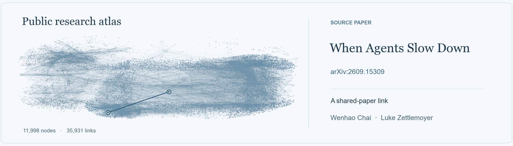

<p align="right"><sub>English · <a href="./README.zh-CN.md">简体中文</a></sub></p>

<h1 align="center"> KnowMe Paper Radar</h1>

<p align="center">Find recent arXiv papers for your research question and inspect the evidence behind their reading priority.</p>

<p align="center">
  <a href="https://arxiv.org/abs/2611.23702"><strong>Paper</strong></a>
  &nbsp;·&nbsp; <a href="https://hackerchenzhuo.github.io/knowme-research-ai/en/#research-atlas"><strong>Interactive atlas</strong></a>
  &nbsp;·&nbsp; <a href="https://chromewebstore.google.com/detail/aneomkhamcijmfmeeegocbknklflilof?hl=en"><strong>Install for Chrome</strong></a>
  &nbsp;·&nbsp; <a href="./CLI.md"><strong>CLI guide</strong></a>
</p>

<a href="https://hackerchenzhuo.github.io/knowme-research-ai/en/#research-atlas"></a>

The atlas links authors through papers they wrote together. Open the example above to explore the public graph, follow a paper to its coauthors, and open the source record.

## How paper selection works

A search for *agent memory* can turn up papers that mention memory in passing and papers that introduce a memory mechanism. Paper Radar starts with the topics you choose, their priorities, a date window and any terms you want to exclude. It ranks matching papers using their titles and abstracts, publication age, and available evidence about the authors’ earlier work and institutional affiliations.

Open a result to see which topics matched and which records contributed to its score. The browser keeps the paper, its version and the supporting links together. As your interests change, you can reuse the cached library under a different profile. Ordinary ranking runs locally without a model API key.

## Try the browser extension

1. [Install Paper Radar](https://chromewebstore.google.com/detail/aneomkhamcijmfmeeegocbknklflilof?hl=en) and select a few topics or enter your own search terms.
2. Choose a date window and refresh from arXiv. Open a result’s score breakdown to inspect the matching evidence.
3. Save a paper or switch profiles and search the cache again. Duplicate versions are grouped under the same paper identifier.

<details>
<summary>View an example paper card</summary>

<p></p>

This earlier interface capture shows the paper’s first submission date, version, and evidence controls. [Browser guide](https://hackerchenzhuo.github.io/knowme-research-ai/en/radar/#guide)

</details>

## Local CLI

Research agents can use the command-line interface to rank a local collection and read the results as JSON Lines. Each paper record carries an arXiv identifier and version, its scores, and the source evidence. The first line describes the ranking run.

Download the [CLI toolkit](https://hackerchenzhuo.github.io/knowme-research-ai/assets/knowme-cli-1.2.7.zip). With Node.js 22.13 or newer, run the included three-paper example from the extracted directory.

```sh
node scripts/rank-research-papers.mjs \
  --input examples/frozen-papers.json --profile examples/profile.json \
  --from 2026-09-01 --to 2026-09-30 \
  --exclude survey --limit 20 --format jsonl > ranked.jsonl
```

The [full CLI guide](./CLI.md) covers installation, input formats, profile settings, and reading the output in another research tool.

## Research

The study follows 174,640 acquired records. Across 58,094 papers matched to sixteen language-model research directions, 64.5% matched through the abstract alone. On fifty expert-judged retrieval tasks, supplying abstracts to the same frozen reranker raised normalized discounted cumulative gain at rank 10 from 0.412 to 0.598. These experiments explain why the tool caches abstracts alongside titles. [Evaluation and system figures](https://hackerchenzhuo.github.io/knowme-research-ai/en/radar/#research-evidence)

[**KnowMe Paper Radar: Lightweight Discovery of Promising Papers in the Age of Autoresearch**](https://arxiv.org/abs/2611.23702)  
Zhuo Chen, Jian Wang, Jinjie Gu, and Lijun Wu. 2026.

<details>
<summary>Cite the paper</summary>

```bibtex
@misc{chen2026knowme,
  title         = {{KnowMe Paper Radar}: Lightweight Discovery of Promising Papers in the Age of Autoresearch},
  author        = {Zhuo Chen and Jian Wang and Jinjie Gu and Lijun Wu},
  year          = {2026},
  eprint        = {2611.23702},
  archivePrefix = {arXiv},
  primaryClass  = {cs.AI},
  url           = {https://arxiv.org/abs/2611.23702}
}
```

</details>

[Report an issue](https://github.com/hackerchenzhuo/knowme-research-ai/issues)

---

## Related tool

**KnowMe AI Translate** translates selected text and preserves Markdown and preferred terminology. [Chrome Web Store](https://chromewebstore.google.com/detail/ggbnigoglmfkdfmjggiifmfoinncblgm?hl=en)
