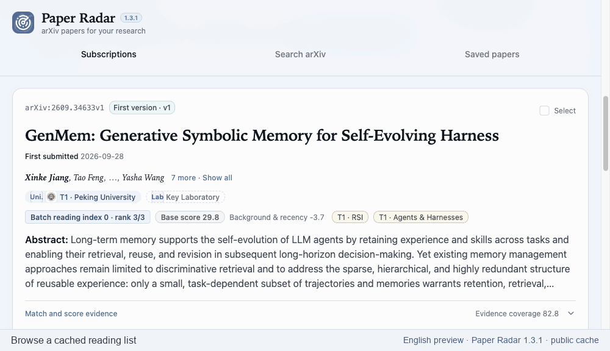

<p align="right"><sub>English · <a href="./README.zh-CN.md">简体中文</a></sub></p>

<p align="center"></p>

<h1 align="center">KnowMe Paper Radar</h1>

<p align="center">A reading list for your research, with a trail back to the papers behind it.</p>

<p align="center">
  <a href="https://arxiv.org/pdf/2611.23702"></a>
  <a href="https://hackerchenzhuo.github.io/knowme-research-ai/en/radar/"></a>
  <a href="https://github.com/hackerchenzhuo/knowme-research-ai/stargazers"></a>
  <a href="https://hackerchenzhuo.github.io/knowme-research-ai/en/#research-atlas"></a>
  <a href="https://chromewebstore.google.com/detail/aneomkhamcijmfmeeegocbknklflilof?hl=en"></a>
  <a href="./CLI.md"></a>
</p>

<a href="https://hackerchenzhuo.github.io/knowme-research-ai/en/radar/"></a>

An English-interface preview of Paper Radar 1.3.1, recorded from the local build with three public cached papers: scroll the subscription list, open the score evidence to see how author credit weights topical relevance, then follow *When Agents Slow Down* through the separate public atlas to its arXiv abstract. [Try the atlas](https://hackerchenzhuo.github.io/knowme-research-ai/en/#research-atlas)

##  How paper selection works

A search for *agent memory* can turn up papers that mention memory in passing and papers that introduce a memory mechanism. Paper Radar starts with the topics you choose, their priorities, a date window and any terms you want to exclude. It ranks matching papers using their titles and abstracts, publication age, and available evidence about the authors’ earlier work and institutional affiliations.

Version 1.3.1, which reaches the Chrome Web Store as an update after review, weights topical relevance by author credit:

$$
s = R \cdot M_a \cdot M_r \cdot F \cdot \Pi .
$$

- $R$ is topical relevance: matched topics, model phrases and your personal author fit.
- $M_a = 1 + 1.25\,(1 - e^{-C/8})$ uses the credit $C$ of the strongest author whose name is bound to a person: by the paper’s own source record, by the author’s affiliation on the paper, or by a shared coauthor with an earlier verified paper. Name-only matches are shown but earn no credit. A top author in a lead role gives $\times 1.99$, and the factor stays below $\times 2.25$.
- $M_r = 1.25$ for institutional technical reports, a collective byline such as “Kimi Team” or a company-led team of at least thirty authors; these reports also fade more slowly.
- $F$ is freshness, and $\Pi$ holds the single-author and venue penalties.

Collaboration credit, which brings rising researchers outside the catalogue into view, and institution profiles for each research direction are shown beside the score rather than inside it. Versions up to 1.2.9, including the current CLI toolkit, instead add author fit, institution context and technical evidence to a base score.

Papers are ordered by the final raw score. The reading index shows a tie-aware percentile within the **complete eligible result pool**, before pagination or an output limit. It is a relative position under that profile, not a probability of paper quality; a one-paper or all-tied pool has no percentile.

Expand the score to inspect its supporting sources. Switching profiles reuses the same local library. Daily ranking needs no model API key.

##  Try the browser extension

1. [Install Paper Radar](https://chromewebstore.google.com/detail/aneomkhamcijmfmeeegocbknklflilof?hl=en) and select a few topics or enter your own search terms.
2. Choose a date window and refresh from arXiv. Open a result’s score breakdown to inspect the matching evidence.
3. Save a paper or switch profiles and search the cache again. Duplicate versions are grouped under the same paper identifier.

<details>
<summary>View an example paper card</summary>

<p></p>

This earlier interface capture shows the paper’s first submission date, version, and evidence controls. [Browser guide](https://hackerchenzhuo.github.io/knowme-research-ai/en/radar/#guide)

</details>

## Local CLI

Research agents can use the command-line interface to rank a local collection and read the results as JSON Lines. Each paper record carries an arXiv identifier and version, its scores, and the source evidence. The first line describes the ranking run.

Download the [CLI 1.2.9 toolkit](https://hackerchenzhuo.github.io/knowme-research-ai/assets/downloads/knowme-cli-1.2.9.zip). With Node.js 22.13 or newer, run the included three-public-paper example from the extracted directory. No npm installation or model key is needed; installing the Chrome extension does not install these terminal commands.

```sh
node scripts/rank-research-papers.mjs \
  --input examples/public-papers.json --profile examples/common-profile.json \
  --from 2026-07-01 --to 2026-09-30 \
  --limit 3 --format jsonl > ranked.jsonl
```

The output separates raw-score components, technical evidence, age relief and the reading index. This example ranks only its three supplied papers; the saved 21,833-paper reference is a separate result.

The [full CLI guide](./CLI.md) covers installation, input formats, profile settings, and reading the output in another research tool.

##  Research

The study follows 174,640 acquired records. Across 58,094 papers matched to sixteen language-model research directions, 64.5% matched through the abstract alone. On fifty expert-judged retrieval tasks, supplying abstracts to the same frozen reranker raised normalized discounted cumulative gain at rank 10 from 0.412 to 0.598. These experiments explain why the tool caches abstracts alongside titles. The forthcoming paper revision adds a sealed test on 10,386 new papers, in which identity-bound author credit doubled the chance of reaching the top tenth of early citations (risk ratio 1.97). [Evaluation and system figures](https://hackerchenzhuo.github.io/knowme-research-ai/en/radar/#research-evidence)

[**KnowMe Paper Radar: Lightweight Discovery of Promising Papers in the Age of Autoresearch**](https://arxiv.org/abs/2611.23702)  
Zhuo Chen, Jian Wang, Jinjie Gu, and Lijun Wu. 2026.

<details>
<summary>Cite the paper</summary>

```bibtex
@misc{chen2026knowme,
  title         = {{KnowMe Paper Radar}: Lightweight Discovery of Promising Papers in the Age of Autoresearch},
  author        = {Zhuo Chen and Jian Wang and Jinjie Gu and Lijun Wu},
  year          = {2026},
  eprint        = {2611.23702},
  archivePrefix = {arXiv},
  primaryClass  = {cs.AI},
  url           = {https://arxiv.org/abs/2611.23702}
}
```

</details>

[Report an issue](https://github.com/hackerchenzhuo/knowme-research-ai/issues)

---

## Related tool

**KnowMe AI Translate** translates selected text and preserves Markdown and preferred terminology. [Chrome Web Store](https://chromewebstore.google.com/detail/ggbnigoglmfkdfmjggiifmfoinncblgm?hl=en)
